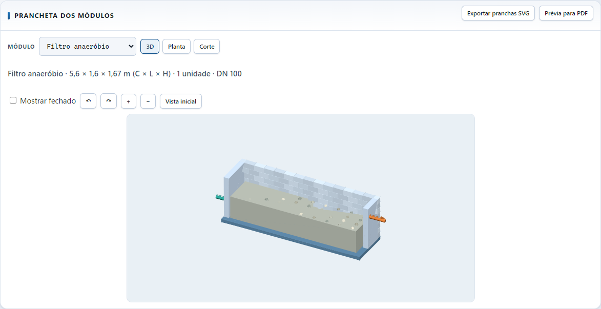
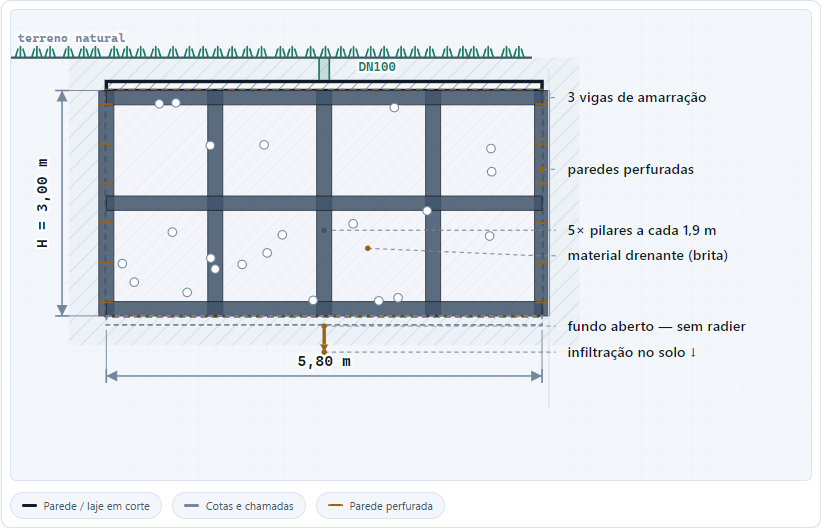
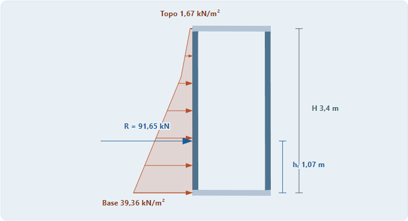
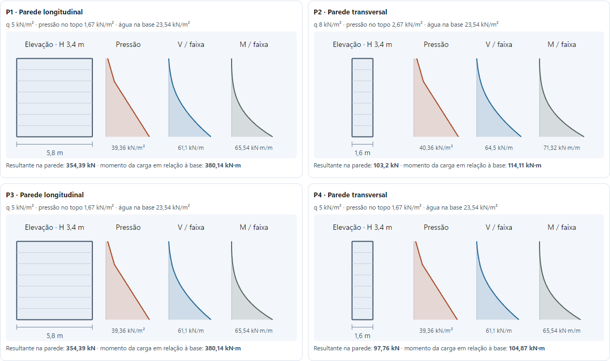
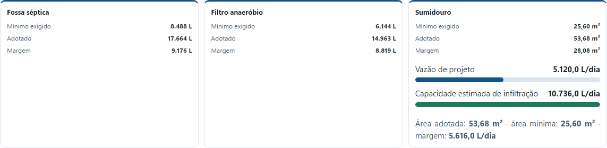

# DRE · Dimensionamento de Redes de Esgoto

Aplicativo desktop para estimar dimensões e quantitativos de fossas sépticas, filtros anaeróbios, sumidouros e caixas de gordura. A aba Projeto reúne as vistas 3D, em planta e em corte, além do esquema de empuxo no sumidouro. O Memorial compara as dimensões mínimas calculadas com as adotadas.

## Projeto e gráficos

As imagens mostram um projeto de demonstração do DRE 6.5.0.

### Prancheta do projeto

Vista 3D em corte do filtro anaeróbio, com o meio filtrante e as tubulações de entrada e saída.



Corte longitudinal do sumidouro, com cotas, paredes perfuradas e indicação do fundo aberto.



### Empuxo e esforços do sumidouro

O esquema frontal mostra a distribuição da pressão externa, a resultante e a altura em que ela atua. Os diagramas por parede mostram pressão, cortante e momento para uma faixa de 1 m em balanço.





### Resumo do memorial

Comparação entre os valores mínimos calculados e os adotados, com gráfico de vazão de projeto e capacidade estimada de infiltração.



## Executar o código-fonte

Com Node.js e npm instalados, abra o PowerShell na raiz do repositório:

```powershell
Set-Location 'Dimensionamento de Fossa 6.0/resources/app'
npm test
npx --yes electron@31.7.7 .
```

O Three.js já está incluído no código. Sua licença acompanha a biblioteca em `resources/app/js/vendor`.

### Motor numérico em Rust

As rotinas de empuxo, esforços da faixa, área de infiltração, desníveis e parcelas de volume são compiladas para WebAssembly. O motor vem incluído no aplicativo e funciona offline.

Para recompilar o motor, execute na raiz do repositório:

```powershell
rustup target add wasm32-unknown-unknown
cargo test --manifest-path motor-rust/Cargo.toml
node motor-rust/gerar-wasm.cjs
```

O arquivo gerado em `resources/app/js/motor-rust.js` é usado pela interface e pelos testes de cálculo. Os arquivos JSON de projeto continuam com o mesmo formato.

## Gerar o instalador para Windows x64

1. Extraia a distribuição oficial **Electron 31.7.7 para Windows x64** na pasta `Dimensionamento de Fossa 6.0`, preservando os arquivos do repositório em `resources/app`.
2. Renomeie `electron.exe` para `Dimensionamento de Fossa 6.0.exe`. Esse nome é usado pelo instalador para atualizar instalações existentes.
3. Execute `./instalador/Gerar-Instalador.ps1` na raiz do repositório. O script usa o compilador do .NET Framework do Windows e gera um instalador gráfico com os arquivos do aplicativo incluídos.

Os desenhos são esquemáticos. Os valores de momento e cortante podem ser informados a partir do modelo estrutural do projeto.
